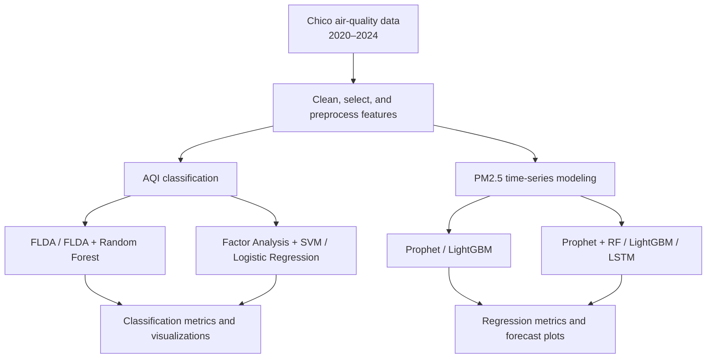

# Air Quality Analysis and Forecasting Using Statistical Learning

**Exploring air-quality classification and PM2.5 time-series forecasting with statistical learning, machine learning, and hybrid models.**

This project analyzes **1,827 daily air-quality records from Chico, California (January 2020–December 2024)**. It studies how pollutant indicators relate to Air Quality Index (AQI) categories and investigates models for forecasting the PM2.5 series. All experiments are provided as Jupyter notebooks, including preprocessing, evaluation, and visualization.

> **Project scope:** This repository is about **air quality**, not stock-price prediction. The original archive name does not match its contents.

## Project Highlights

- **AQI classification:** Compare Fisher's Linear Discriminant Analysis (FLDA), FLDA + Random Forest, and Factor Analysis with SVM or Logistic Regression.
- **PM2.5 forecasting:** Explore Prophet, LightGBM, and hybrid Prophet models that correct Prophet residuals using Random Forest, LightGBM, or LSTM.
- **Exploratory forecasting:** Visualize historical fits, predictions, and up to five years of projected values.
- **Model interpretation:** Generate factor loadings, class projections, confusion matrices, classification reports, feature-importance plots, and actual-versus-predicted charts.

## Research Workflow



## Dataset

| Property | Details |
| --- | --- |
| Location | Chico, California, USA |
| Period | January 1, 2020–December 31, 2024 |
| Records | 1,827 daily observations |
| Original file | `dataset/Chico_CA_2020_2024.csv` |
| Preprocessed files | `dataset/preprocessed_data_unscaled.csv`, `dataset/preprocessed_data_minmax_scaled.csv` |
| Main fields | `Date`, `Overall AQI Value`, `CO`, `Ozone`, `PM10`, `PM25`, `NO2` |

The original CSV also includes the main pollutant, station/site details, and an `AQS` source field. The preprocessing notebook produces unscaled and Min-Max-scaled versions of the selected columns; the saved **Overall AQI Value** remains the AQI target used to define classes.

**AQI classification labels used in the notebooks:**

- **Three-class setting:** Good (0–50), Moderate (51–100), Unhealthy (above 100).
- **Two-class setting:** AQI up to 100 (called *Moderate* in the notebook) versus above 100 (*Unhealthy*). The first binary class therefore **also includes Good observations**.

These are project-specific groupings, not a complete official AQI category system. The dataset contains relatively few observations in the Unhealthy category.

## Methods

### 1. AQI Classification

| Approach | Implementation | Purpose |
| --- | --- | --- |
| Fisher LDA | `Classification Model/Fisher_Analysis.ipynb` | Learn discriminative directions and classify AQI categories |
| Fisher LDA + Random Forest | `Classification Model/Fisher_Analysis_RF.ipynb` | Classify transformed LDA features with an ensemble model |
| Factor Analysis + SVM | `Classification Model/Factor analysis.ipynb` | Reduce pollutant data to latent factors and use a nonlinear classifier |
| Factor Analysis + Logistic Regression | `Classification Model/Factor analysis.ipynb` | Provide a simpler baseline using the same factor scores |

The classification notebooks use stratified 80/20 train/test splits (random seed 42). The Factor Analysis notebook fits its factor model before splitting; see the [evaluation limitations](#evaluation-limitations) below.

### 2. PM2.5 Forecasting

| Approach | Implementation | Purpose |
| --- | --- | --- |
| Prophet | `Predict Model/Prophet.ipynb` | Capture trend and calendar seasonality |
| LightGBM | `Predict Model/LGBM.ipynb` | Learn from lag, rolling-window, calendar, and pollutant features |
| Prophet + Random Forest | `Predict Model/Prophet_hybrid.ipynb` | Model Prophet residuals using Random Forest |
| Prophet + LightGBM | `Predict Model/Prophet_hybrid.ipynb` | Model Prophet residuals using gradient-boosted trees |
| Prophet + LSTM | `Predict Model/Prophet_hybrid.ipynb` | Explore sequential learning of Prophet residuals |

The hybrid design combines a Prophet estimate with a learned residual correction:

\[
\widehat{y}_{\mathrm{hybrid}}(t) = \widehat{y}_{\mathrm{Prophet}}(t) + \widehat{r}(t)
\]

The notebooks also construct five-year forecast visualizations. These projections are **exploratory**, not validated estimates of long-term forecast accuracy.

## Results Recorded in the Notebooks

The following numbers come from the **saved notebook outputs** in this repository. They have not been independently rerun as part of this README update.

### AQI Classification Accuracy

| Model | Two-class accuracy | Three-class accuracy |
| --- | ---: | ---: |
| Fisher LDA | 99.73% | 92.35% |
| Fisher LDA + Random Forest | 99.45% | 92.08% |
| Factor Analysis + SVM | — | 94.81% |
| Factor Analysis + Logistic Regression | — | 92.08% |

These are classification results for the defined AQI categories, **not** future PM2.5 forecasting accuracy. The Unhealthy class has only 15 instances in the 366-row classification test set, so accuracy should be considered alongside per-class precision, recall, F1, and the confusion matrices.

### PM2.5 Modeling Metrics

| Model | Notebook evaluation | RMSE | R² |
| --- | --- | ---: | ---: |
| Prophet | Historical fit | 24.9733 | 0.3770 |
| LightGBM | Chronological final 20% test split* | 7.1056 | 0.8904 |
| Prophet + Random Forest | Historical fit / training data | 6.9525 | 0.9517 |
| Prophet + LightGBM | Historical fit / training data | 16.7033 | 0.7213 |
| Prophet + LSTM | Historical fit / training data | 18.2693 | 0.6666 |

**Important:** These rows are **not directly comparable benchmarks**: Prophet and the hybrid models are evaluated against data used for model fitting, while LightGBM uses a chronological holdout. *The current LightGBM notebook also contains target-derived same-day predictors; its test score is therefore susceptible to target leakage.* See the next section before interpreting any number as production forecasting performance.

## Evaluation Limitations

This is an **experimental/educational project**, rather than a validated production forecasting service.

1. **Target leakage in the LightGBM notebook:** The features `PM10_PM25_ratio` and `PM25_roc_1` are calculated using the PM2.5 value of the same row being predicted. These should be removed or replaced by strictly historical features for a genuine ahead-of-time forecasting test.
2. **In-sample evaluation of Prophet and hybrids:** Most regression scores are computed on dates included in fitting. Strong historical fit does not guarantee performance on unseen future dates. A common, chronological holdout or rolling-origin backtest is needed.
3. **Factor Analysis before train/test split:** The factor transformation is learned using the full dataset before classification splitting. For unbiased testing, fit it only on training data (for example, with a scikit-learn `Pipeline`).
4. **Forecast uncertainty:** The long-horizon charts and uncertainty bounds are exploratory; they have not been calibrated or validated as reliable coverage intervals.
5. **Class distribution:** High overall accuracy can obscure performance for less-represented AQI categories. Review macro-averaged and per-class metrics.

**Recommended next experiment:** Remove target-derived future information, adopt consistent chronological validation for every forecasting model, retrain, and compare RMSE/MAE on exactly the same held-out dates.

## Repository Structure

```text
.
├── Classification Model/
│   ├── Factor analysis.ipynb
│   ├── Fisher_Analysis.ipynb
│   └── Fisher_Analysis_RF.ipynb
├── Predict Model/
│   ├── LGBM.ipynb
│   ├── Prophet.ipynb
│   ├── Prophet_hybrid.ipynb
│   └── prophet_model.pkl
├── dataset/
│   ├── Chico_CA_2020_2024.csv
│   ├── Data_preprocessing.ipynb
│   ├── preprocessed_data_minmax_scaled.csv
│   └── preprocessed_data_unscaled.csv
└── README.md
```

## Getting Started

### 1. Set Up Python

Python **3.11** is a reasonable starting point for these notebooks. From your project directory:

```bash
python -m venv .venv
```

Activate the environment:

```powershell
# Windows PowerShell
.\.venv\Scripts\Activate.ps1
```

Or on macOS/Linux:

```bash
source .venv/bin/activate
```

Install the notebook dependencies:

```bash
python -m pip install --upgrade pip
python -m pip install numpy pandas matplotlib seaborn scikit-learn lightgbm prophet tensorflow joblib notebook ipykernel
```

> The archive does not include a pinned dependency lockfile. Library-version differences can affect results; a pinned `requirements.txt` or environment file would improve reproducibility.

### 2. Explore or Rebuild the Dataset

The processed CSV files are already included. To regenerate them, open a terminal **inside the `dataset` directory** and run:

```bash
jupyter notebook Data_preprocessing.ipynb
```

Run notebook cells in order. It reads `Chico_CA_2020_2024.csv` and generates the two processed CSV files.

### 3. Run AQI Classification Experiments

Start Jupyter inside `Classification Model`, then open any of:

- `Fisher_Analysis.ipynb`
- `Fisher_Analysis_RF.ipynb`
- `Factor analysis.ipynb`

These notebooks read the scaled dataset using a relative path to `../dataset/`.

### 4. Run PM2.5 Forecasting Experiments

Start Jupyter inside `Predict Model`. Run:

1. `Prophet.ipynb` to train Prophet and save `prophet_model.pkl`.
2. `LGBM.ipynb` to train the standalone gradient-boosting model.
3. `Prophet_hybrid.ipynb` to load the saved Prophet artifact and explore the residual-based hybrid models.

The hybrid notebook depends on `prophet_model.pkl`, which is included in the uploaded project. **Only load serialized model artifacts that you trust**, because Python pickle-based formats can execute code during loading.

**Path note:** Because several notebook paths are relative to their respective directories, start Jupyter **from the relevant folder** rather than changing the notebooks' working directories unexpectedly.

## Technology Stack

**Language and notebooks:** Python, Jupyter Notebook  
**Data and visualization:** pandas, NumPy, Matplotlib, Seaborn  
**Statistical learning and machine learning:** scikit-learn, LightGBM, Prophet  
**Deep learning:** TensorFlow / Keras (LSTM experiment)  
**Model persistence:** joblib

## Future Improvements

- Use leakage-free lagged features and walk-forward backtesting for forecasting.
- Compare all forecasting models over the same test period with the same metrics.
- Add reproducible environment files and scripts for training and evaluation.
- Document the external dataset's provenance and applicable license.
- Calibrate prediction intervals before interpreting forecast uncertainty.
- Optionally build an interactive dashboard to explore the daily air-quality records and model forecasts.

## Maintainer

Repository maintained by [WAYTECHG](https://github.com/WAYTECHG).

---

*For research, education, and reproducible experiments. Forecasts and classification outputs should not be treated as live environmental monitoring or public-health alerts.*
